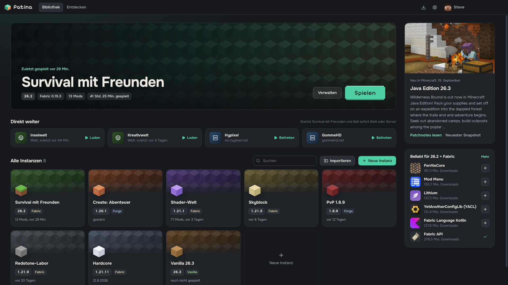
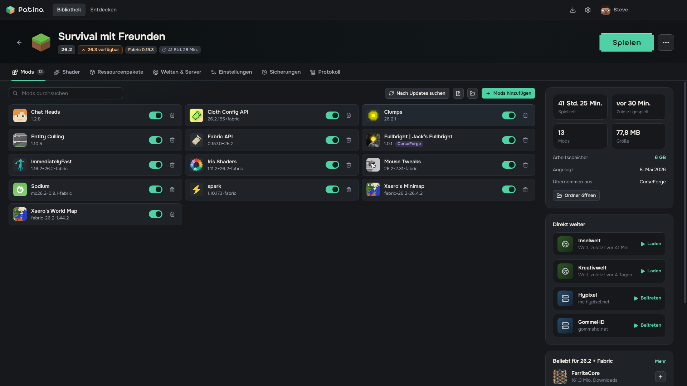
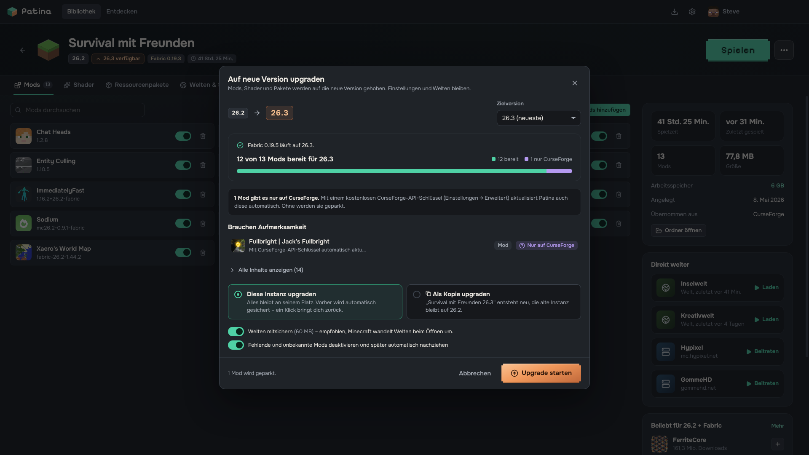
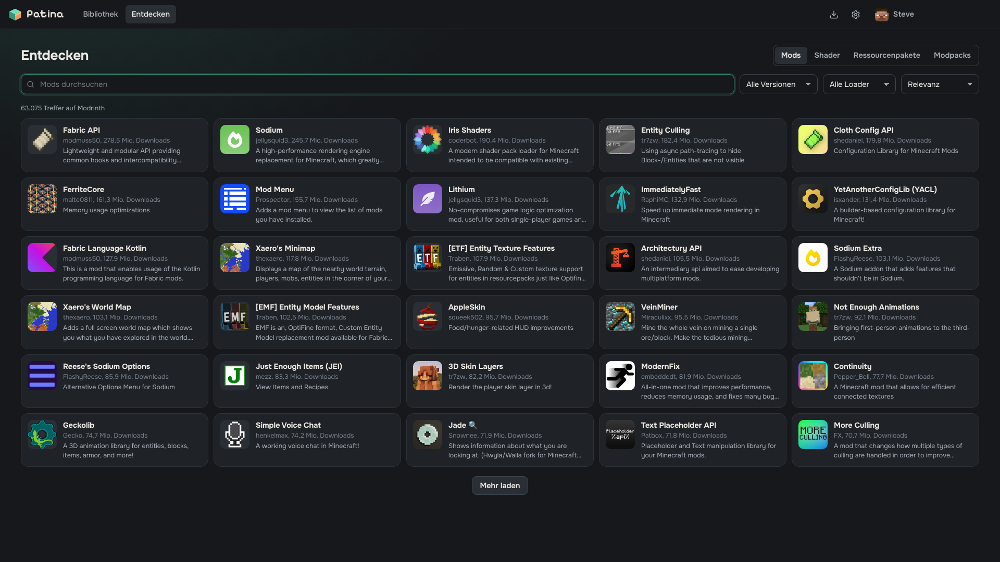
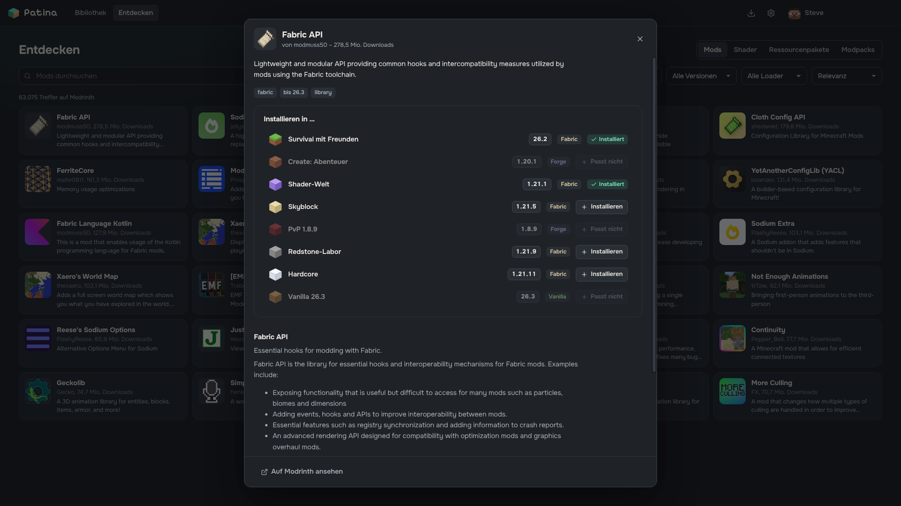
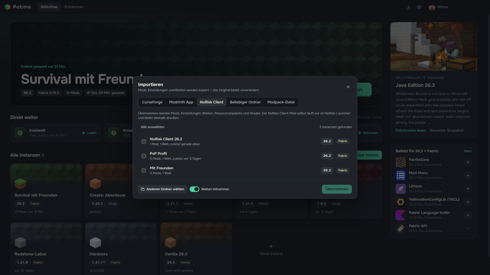
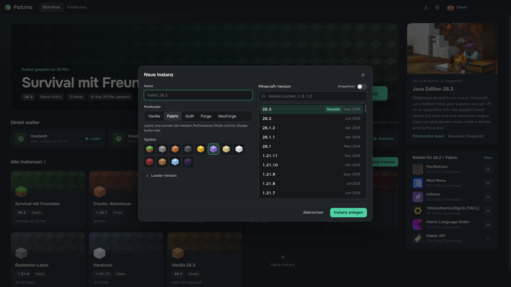

# Patina – Minecraft-Launcher

Ein Minecraft-Launcher für Windows, der die guten Seiten von CurseForge, Modrinth und dem offiziellen Launcher vereint. Das Besondere: **Neue Minecraft-Version? Ein Klick** – Patina hebt alle Mods, Shader und Ressourcenpakete auf die neue Version, Einstellungen und Welten bleiben erhalten.

Der Name: Patina ist die grüne Schicht, die Kupfer mit der Zeit ansetzt – wie die Kupferblöcke in Minecraft. Deine Instanzen werden älter, Patina nimmt sie auf jede neue Version mit.



## Was Patina kann

- **1-Klick-Upgrade** auf neue Minecraft-Versionen – mit Vorschau („12 von 13 Mods bereit“), automatischer Sicherung und Rückgängig-Knopf. Mods, die es noch nicht gibt, werden geparkt und später automatisch nachgezogen.
- **Alle Modloader:** Vanilla, Fabric, Quilt, Forge und NeoForge – auch alte Versionen wie 1.8.9.
- **Direkt spielen:** „Spielen“ startet Minecraft sofort, ohne den offiziellen Launcher. Welten und Server lassen sich direkt laden, auf Wunsch auch per Desktop-Verknüpfung.
- **Mods, Shader, Ressourcenpakete und Modpacks** von Modrinth – mit Abhängigkeiten und Update-Prüfung. Shader per Klick (Iris/Sodium bzw. Oculus werden automatisch eingerichtet).
- **Umzug leicht gemacht:** Instanzen aus CurseForge, der Modrinth App und dem NoRisk Client übernehmen – mit Mods, Einstellungen und Welten. Außerdem beliebige Ordner und .mrpack-Dateien.
- **Immer aktuell:** Versionsliste direkt von Mojang, Patchnotes zur neuesten Version auf der Startseite.
- **Java automatisch:** Die passende Java-Version wird selbst geladen.

## Screenshots

| | |
|---|---|
|  |  |
| **Instanz:** Mods, Shader, Welten & Server, Seitenleiste mit Überblick | **Upgrade-Vorschau:** was mitkommt, was geparkt wird |
|  |  |
| **Entdecken:** Mods, Shader, Ressourcenpakete, Modpacks | **Installieren:** zeigt, in welche Instanzen eine Mod passt |
|  |  |
| **Importieren:** CurseForge, Modrinth App, NoRisk Client | **Neue Instanz:** Version und Modloader wählen |

## Installation

1. Unter [**Releases**](https://github.com/Samuel1800/patina-launcher/releases/latest) die Datei `Patina-Setup-1.2.0.exe` herunterladen.
2. Doppelklicken – Patina installiert sich (ohne Admin-Rechte) und startet direkt.
3. Mit dem eigenen Microsoft-Konto anmelden. Du brauchst Minecraft: Java Edition.

Windows warnt beim ersten Start eventuell („Der Computer wurde geschützt“), weil die Datei nicht signiert ist: **Weitere Informationen → Trotzdem ausführen**.
Prüfsumme (SHA-256) von `Patina-Setup-1.2.0.exe`:
`0c4197c0eebfcd96691385f3e500be50dcbeb759fd3df3371906012fadeaade8`

Voraussetzungen: Windows 10/11 (64 Bit). Deinstallieren über *Einstellungen → Apps*.

## Sicherheit & Datenschutz

- Kein eigener Server, kein Tracking: Anmeldung und Spieldaten bleiben auf deinem PC. Die Anmeldung läuft direkt über Microsoft/Mojang und wird mit Windows-Verschlüsselung gespeichert.
- Alle Downloads laufen verschlüsselt (https) und werden, wo möglich, per Prüfsumme kontrolliert.
- Modpacks dürfen nur von offiziellen Modrinth-Quellen laden und keine Dateien außerhalb ihrer Instanz schreiben.
- Mods sind Programme – installiere nur Mods und Modpacks aus Quellen, denen du vertraust.

## Selbst bauen

Voraussetzung: Node.js 22 oder neuer.

```
npm install
npm start      # Oberfläche bauen und Patina starten
npm test       # Tests
npm run dist   # Windows-Installer bauen (release/)
```

Aufbau: `core/` enthält die Launcher-Logik (läuft ohne Electron und ist testbar), `electron/` Fenster, Anmeldung und Direktstart, `renderer/` die Oberfläche (React + Vite), `test/` die Tests.

---

Patina ist kein offizielles Minecraft-Produkt und steht in keiner Verbindung zu Mojang oder Microsoft.
